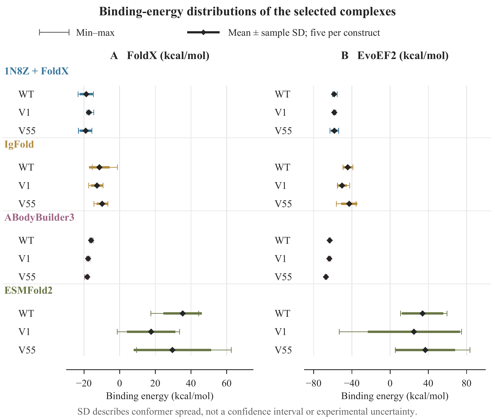
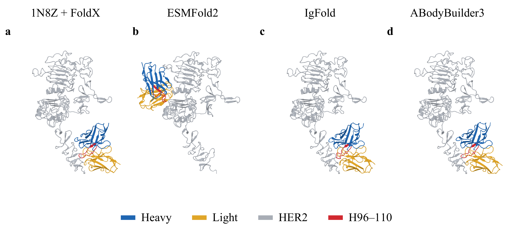

# Supplementary Appendix for CSAI 2026 Paper 126

Associated manuscript: **Evaluating AI-Based Trastuzumab Affinity Workflows in a Two-Variant Case Study**.

The scientific content below is reproduced from the final manuscript’s Appendix A1–A8. The A-numbered identifiers are unchanged. References retain the manuscript’s numbering.

[Download PDF](CSAI126_Supplementary_Appendix.pdf) · [Download Word](CSAI126_Supplementary_Appendix.docx)

Publication note (29 October 2026): This online supplement preserves Appendix A1–A8 from the final manuscript. References to the evidence archive or original companion below describe the separately retained research package. The public GitHub repository contains this appendix, its displayed tables and figures, and eight selected numerical CSV files; it does not contain the full evidence archive.

Trastuzumab structure and affinity comparison

The appendix documents the five-structure mean analysis of 834-residue Fv–HER2 complexes. Reference numbers follow the main manuscript. WT, V1 and V55 denote wild type, Variant 1 and Variant 55. The primary cohort contains 60 complexes; all 68 scored records are retained for provenance. The machine-readable companion provides full IDs, selection flags and calculations.

Numeric display rule. Floating-point results are shown to two decimal places. Nonzero magnitudes below 0.01 use scientific notation with a two-decimal mantissa. Conditional KD values also use scientific notation when below 0.10 nM or at least 10,000 nM; other conditional KD values use fixed two-decimal notation. Primary calculations, including Appendix A8, use the retained source scores without additional rounding. The companion retains source inputs, intermediate values, R and RT constants, and provenance hashes; the report-precision comparison is labeled separately.

## A1 Sequences and experimental reference

**Table A1. Sequence-defined constructs and BLI reference.**

| Variant | Printed segment VH 96–110 | VH substitutions | KD (nM) | ΔΔGexp (kcal mol−1) |
| --- | --- | --- | --- | --- |
| WT | CSRWGGDGFYAMDYW | None | 0.40 | 0.00 |
| V1 | CSRWKGDGFYEHDYW | G100K, A106E, M107H | 0.33 | −0.11 |
| V55 | CSRYGQPGLYEHDYW | W99Y, G101Q, D102P, F104L, A106E, M107H | 18.34 | 2.27 |

[Download Table A1 as CSV](Table_A01.csv)

KD values are from Mason et al., Supplementary Table 6 [5]. Energy values are calculated only for discussion using 298.15 K, the appendix&#x27;s exact arithmetic convention corresponding to the main text&#x27;s rounded 298 K description. WT is the anchor. Substitution numbers refer to sequential chain H positions (source chain B), not an asserted Kabat/IMGT conversion.

### WT VH 120 residues

`EVQLVESGGGLVQPGGSLRLSCAASGFNIKDTYIHWVRQAPGKGLEWVARIYPTNGYTRY`

`ADSVKGRFTISADTSKNTAYLQMNSLRAEDTAVYYCSRWGGDGFYAMDYWGQGTLVTVSS`

### V1 VH 120 residues

`EVQLVESGGGLVQPGGSLRLSCAASGFNIKDTYIHWVRQAPGKGLEWVARIYPTNGYTRY`

`ADSVKGRFTISADTSKNTAYLQMNSLRAEDTAVYYCSRWKGDGFYEHDYWGQGTLVTVSS`

### V55 VH 120 residues

`EVQLVESGGGLVQPGGSLRLSCAASGFNIKDTYIHWVRQAPGKGLEWVARIYPTNGYTRY`

`ADSVKGRFTISADTSKNTAYLQMNSLRAEDTAVYYCSRYGQPGLYEHDYWGQGTLVTVSS`

### Unchanged VL 107 residues

`DIQMTQSPSSLSASVGDRVTITCRASQDVNTAVAWYQQKPGKAPKLLIYSASFLYSGVPS`

`RFSGSRSGTDFTLTISSLQPEDFATYYCQQHYTTPPTFGQGTKVEIK`

### HER2 construct 607 residues

`TQVCTGTDMKLRLPASPETHLDMLRHLYQGCQVVQGNLELTYLPTNASLSFLQDIQEVQG`

`YVLIAHNQVRQVPLQRLRIVRGTQLFEDNYALAVLDNGDPLNNTTPVTGASPGGLRELQL`

`RSLTEILKGGVLIQRNPQLCYQDTILWKDIFHKNNQLALTLIDTNRSRACHPCSPMCKGS`

`RCWGESSEDCQSLTRTVCAGGCARCKGPLPTDCCHEQCAAGCTGPKHSDCLACLHFNHSG`

`ICELHCPALVTYNTDTFESMPNPEGRYTFGASCVTACPYNYLSTDVGSCTLVCPLHNQEV`

`TAEDGTQRCEKCSKPCARVCYGLGMEHLREVRAVTSANIQEFAGCKKIFGSLAFLPESFD`

`GDPASNTAPLQPEQLQVFETLEEITGYLYISAWPDSLPDLSVFQNLQVIRGRILHNGAYS`

`LTLQGLGISWLGLRSLRELGSGLALIHHNTHLCFVHTVPWDQLFRNPHQALLHTANRPED`

`ECVGEGLACHQLCARGHCWGPGPTQCVNCSQFLRGQECVEECRVLQGLPREYVNARHCLP`

`CHPECQPQNGSVTCFGPEADQCVACAHYKDPPFCVARCPSGVKPDLSYMPIWKFPDEEGA`

`CQPCPIN`

All chains are numbered sequentially from 1. Source 1N8Z chains B/A/C map to output H/L/A. The template manifest identifies modeled HER2 positions 102–110, 303–305, 361–364 and 581–590 (26 residues). These are study-chain positions; a canonical HER2 numbering map was not supplied. The common HER2 sequence is not the full-length receptor.

### Specified disulfide pairs

L23–L88; H22–H96; A4–A31; A140–A170; A173–A182; A177–A190; A198–A205; A202–A213; A214–A222; A218–A230; A233–A242; A246–A273; A277–A289; A293–A309; A312–A316; A320–A345; A453–A482; A489–A498; A493–A506; A509–A518; A522–A538; A541–A554; A545–A562; A565–A574; A578–A601.

## A2 Protocol and reproducibility records

ESMFold2 received separate H, L and HER2 entities and retained its predicted three-chain coordinates without a framework assembly transform. Other routes inherited the template orientation and underwent local restrained repair. The archive contains the selected coordinates and scoring execution records, embedded refinement audits for all 53 repaired outputs, and QC/confidence and inference metadata for all 52 ESMFold2 candidates. It does not contain a complete upstream rerun record: referenced template, IgFold and ABodyBuilder3 parent coordinates and original generation invocations remain unrecovered, and 37 unselected ESMFold2 candidates lack archived coordinates. Table A2 and the inventory below distinguish retained records from these limits; absence from the archive does not establish that a record was never generated.

**Table A2. Recorded software and model identity.**

| Stage | Recorded identity and settings |
| --- | --- |
| ESMFold2 | Python 3.12.3; esm 3.4.1; torch 2.11.0; transformers 4.57.6; biopython 1.88. Loops=20; sampling steps=100; diffusion samples=1; esmc_offload=true. Per-candidate seeds and checkpoint hashes retained; literal inference command not archived. |
| IgFold parents | Checkpoint families 1, 2, 3, 5, 1 in repair-group order. Original package version, command and weight hashes unavailable. |
| ABodyBuilder3 parents | pLDDT-loss/base-loss alternate over six repair groups. Base-loss has no pLDDT head. Original package version, command and weight hashes unavailable. |
| Template parents | FoldX BuildModel runs 1–5, each with variant-specific WT controls. Parent-generation executable identity and original RepairPDB/BuildModel arguments unavailable. |
| Repair | OpenMM 8.6; CUDA mixed precision; 8 threads. amber14/protein.ff14SB.xml plus implicit/obc2.xml; pH 7; 25 specified disulfides. |
| FoldX scoring | Version 5.1 verified in scoring logs. AnalyseComplex; analyseComplexChains=HL,A; temperature=298.15; pH=7; water=IGNORE. repair_before_scoring=false. |
| EvoEF2 scoring | ComputeBinding; split=HL,A; Total binding-interaction energy, kcal mol−1 [8]. Executable hash recorded; version/commit unavailable. repair_before_scoring=false. |

[Download Table A2 as CSV](Table_A02.csv)

### Repair and stopping procedure

Apply seeded Gaussian coordinate perturbations with SD 0.05 Å to backbone and SD 0.20 Å to side chains, as specified in the embedded refinement settings. Restrain the parent geometry with a harmonic potential using 0.5 k d², k = 1000 and 100 kJ mol−1 nm−2 for backbone and side chains. Minimize with at most 1000 iterations at force tolerance 10 kJ mol−1 nm−1, followed by at most 5000 at tolerance 1. Recorded final RMS forces were below 1 kJ mol−1 nm−1. Admit only structures meeting QC and per-chain movement limits of 1 Å Cα RMSD and 2 Å heavy-atom RMSD. Absolute movement metrics are recorded relative to the parent; the unarchived parent files are required to recalculate them.

Use repair seeds 9103000–9103004 for IgFold and template FoldX, and 9103000–9103005 for ABodyBuilder3. Template groups contain a separate WT–V1 pair and WT–V55 pair. IgFold groups cycle checkpoint families 1, 2, 3, 5, 1; ABodyBuilder3 alternates pLDDT-loss and base-loss. Score QC-accepted structures immediately and stop after the current group once each construct has at least five distinct, doubly scored structures. CPU retries with the same seed are not new observations.

**Table A3. Structural admission thresholds.**

| Check | Strict bound | Exploratory bound |
| --- | --- | --- |
| Intraresidue C–C (Å) | 1.15–1.80 | 1.05–1.90 |
| Intraresidue C–N (Å) | 1.10–1.75 | 1.00–1.85 |
| Intraresidue C–O (Å) | 1.05–1.65 | 0.95–1.75 |
| Intraresidue C–S (Å) | 1.55–2.05 | 1.45–2.15 |
| Peptide C–N (Å) | 1.10–1.80 | 1.00–2.00 |
| Specified disulfide SG–SG (Å) | 1.70–3.10 | Unchanged |
| Severe nonbonded heavy-atom distance | No pair &lt;1.2 Å | Unchanged |
| Antibody–HER2 contacts | ≥3 residue pairs within 5 Å | Unchanged |
| Combined framework Cα RMSD | ≤4 Å | Unchanged |
| Sequence and coordinates | Exact coverage; required heavy atoms; finite coordinates | Unchanged |

[Download Table A3 as CSV](Table_A03.csv)

Bonded exclusions apply to clash screening. Short nonbonded contacts below 1.8 Å and disulfide distances above 2.3 Å generate warnings. Strict-tier means compliance with the listed admission checks, not verified biological validity. No native-epitope test, minimum ipTM, or comprehensive Ramachandran, chirality and peptide-planarity gate was applied. The full framework mask and exclusion implementation were not included in the export.

### ESMFold2 selection

The 52-candidate inventory contains WT/V1/V55 counts of 18/17/17; 12/9/10 were QC-eligible. The retained selection script filters on QC pass, orders strict tier first and then descending ipTM, pTM and mean pLDDT with identifier tie-breaking, and greedily keeps models distinct from previously retained models of the same construct. The recorded threshold is at least 0.10 Å in internal Fv RMSD or antigen-aligned Fv-pose RMSD. Selection stops at five per construct; scoring follows selection, and neither energy nor experimental KD enters the ranking. Among 17 V1 candidates, four passed strict QC (seeds 3, 14, 16 and 15), five passed exploratory QC only and eight failed. Seed9 had the highest ipTM among the additional exploratory-only passes and was retained fifth after the four strict passes. Higher-ipTM seeds 10 and 4 failed the disulfide hard gate. The record-level ranking therefore explains seed9 inclusion. All-candidate geometry and distinctness cannot be independently recomputed without the 37 unarchived candidate coordinate sets and the complete QC implementation. The initial candidate-sampling stop rule remains unrecovered.

### Fingerprints and source files

Source 1N8Z SHA-256: ed934d36503335c6764b08880f9e5093 3d99eb13b9bf145339cfcaee150eb21e

ESMFold2 model.safetensors SHA-256: 138fd4350d6892b81ce6be7ff9bf5a93 ae9d4d3751f46a27438a3f9f0dcefa0e

FoldX scoring executable SHA-256: 3f892047bc23997ae21d71a34c1c5e62 01e394a997694587cbe5e66c11557aa7

EvoEF2 executable SHA-256: 140cf4a0699a4ddda36e50cb03e12c34 e8e033c357d9099606e2a7918721fade

Repair code SHA-256: 107c6a3575c98e461897bc52ebb2fbe3 405b690e8328f04874e7ac6b9aba1bde

1N8Z + FoldX evidence.json SHA-256: ed10beb4ddad2ef323809df1e4565865 f0bf3b40f1e2599a78553ba0dda026cb

ESMFold2 evidence.json SHA-256: fa39abf525a97213b87db527147f3a83 616051d69db2cf366cc7f7a4a08cd1d3

IgFold evidence.json SHA-256: 8d32d97f9d7094e63f5ba25905d042d6 f65e57a85da9ddabf79e48a224e64943

ABodyBuilder3 evidence.json SHA-256: 6b9ea1d6f66812ff0d739859566d4d2c 20d8f02800321d5d6f9314c68aaf7fd8

Spaces in the displayed hashes separate two 32-character blocks; concatenate them for verification. Within mason_four_routes_two_scores_20260911, each route retains evidence/evidence.json, a selected_scores.csv (ESMFold2) or raw_scores.csv, selected PDBs and evidence/scores/{foldx,evoef2}/RECORD_ID/attempt-001 command/result/program files with scoring inputs. All 60 selected coordinates and 120 selected scoring bundles were located and checked. ESMFold2 metadata retain per-candidate seeds, software versions, inference parameters and checkpoint hashes, including the ESMFold2 model and six ESMC weight shards; weight binaries are not distributed. All 52 candidate QC/confidence summaries are retained, but only 15 selected candidate coordinates are archived. Raw prediction/confidence output files referenced by their hash maps are not archived.

For the three repaired routes, the embedded audits retain Gaussian perturbation settings, force-field names, seeds, software/platform identity and code/input/output hashes. The 12 IgFold, six ABodyBuilder3 and 20 template parent paths referenced across all records are not archived. Original upstream prediction/model-building invocations and relevant checkpoint/version provenance, the matching repair source, and force-field XML hashes remain unrecovered. A separately supplied 1N8Z file matches the recorded source hash and supports Appendix A7; it does not replace those route parents.

A historical export_esm_top5.py script was recovered from the original workspace during this revision and is identified separately in the supplement (SHA-256 96cd0003d5e73934a69c1525ff086a4c2cff031da608e0b78a4e5c7f4d514bf6). It confirms tier-first ranking, distinctness filtering, scoring after selection and export of selected coordinate sets. It was not part of the original data package. Its complete imported QC/geometry dependency chain and inference execution history were not recovered; no end-to-end rerun is claimed.

## A3 Structural quality and confidence

**Table A4. Selected ESMFold2 model quality and confidence.**

| Model | Rank | Tier | ipTM | pTM | Mean pLDDT | Fv fit (Å) | Contacts | Short |
| --- | --- | --- | --- | --- | --- | --- | --- | --- |
| WT s7 | 1 | strict | 0.28 | 0.68 | 0.86 | 0.49 | 67 | 1 |
| WT s15 | 2 | strict | 0.28 | 0.68 | 0.86 | 0.45 | 57 | 3 |
| WT s1 | 3 | strict | 0.28 | 0.67 | 0.86 | 0.47 | 49 | 1 |
| WT s14 | 4 | strict | 0.28 | 0.68 | 0.86 | 0.46 | 89 | 0 |
| WT s2 | 5 | strict | 0.26 | 0.67 | 0.85 | 0.48 | 84 | 1 |
| V1 s3 | 1 | strict | 0.33 | 0.73 | 0.86 | 0.49 | 103 | 2 |
| V1 s14 | 2 | strict | 0.30 | 0.70 | 0.85 | 0.50 | 90 | 1 |
| V1 s16 | 3 | strict | 0.29 | 0.69 | 0.86 | 0.46 | 103 | 0 |
| V1 s15 | 4 | strict | 0.26 | 0.68 | 0.85 | 0.45 | 35 | 1 |
| V1 s9 | 5 | exploratory | 0.83 | 0.88 | 0.88 | 0.48 | 121 | 0 |
| V55 s0 | 1 | strict | 0.32 | 0.70 | 0.86 | 0.56 | 61 | 1 |
| V55 s11 | 2 | strict | 0.28 | 0.68 | 0.85 | 0.45 | 85 | 1 |
| V55 s1 | 3 | strict | 0.27 | 0.68 | 0.85 | 0.49 | 48 | 1 |
| V55 s12 | 4 | strict | 0.27 | 0.68 | 0.85 | 0.53 | 88 | 1 |
| V55 s16 | 5 | strict | 0.27 | 0.68 | 0.85 | 0.42 | 56 | 0 |

[Download Table A4 as CSV](Table_A04.csv)

Confidence retains its recorded 0–1 scale. Rank is selection order within construct, not energy rank. Contacts are antibody–HER2 residue pairs within 5 Å; Short counts nonbonded contacts below 1.80 Å. All models have zero severe clashes and complete required heavy atoms. V1 s9 has terminal H120/A607 C–O lengths of 1.0192/1.0095 Å: these fail the strict 1.05–1.65 Å interval but satisfy the exploratory 0.95–1.75 Å interval. Its A202–A213 disulfide distance of 2.3035 Å triggers the 2.30 Å warning, not the 1.70–3.10 Å rejection gate. All other selected models are strict. Framework fit does not establish native epitope recovery.

**Table A5. QC ranges across all repaired outputs.**

| Route | Variant | n | Framework RMSD (Å) | Contacts | Maximum-chain Cα move (Å) |
| --- | --- | --- | --- | --- | --- |
| 1N8Z + FoldX | WT | 10 | 0.19–0.19 | 47–49 | 0.23–0.23 |
| 1N8Z + FoldX | V1 | 5 | 0.19–0.20 | 50–52 | 0.22–0.24 |
| 1N8Z + FoldX | V55 | 5 | 0.19–0.21 | 50–52 | 0.23–0.23 |
| IgFold | WT | 5 | 0.58–0.59 | 44–56 | 0.24–0.27 |
| IgFold | V1 | 5 | 0.57–0.63 | 53–61 | 0.24–0.28 |
| IgFold | V55 | 5 | 0.55–0.64 | 42–52 | 0.24–0.30 |
| ABodyBuilder3 | WT | 6 | 0.70–0.74 | 47–52 | 0.23–0.24 |
| ABodyBuilder3 | V1 | 6 | 0.70–0.77 | 48–51 | 0.23–0.24 |
| ABodyBuilder3 | V55 | 6 | 0.69–0.77 | 51–52 | 0.23–0.24 |

[Download Table A5 as CSV](Table_A05.csv)

All 53 repaired records are strict-tier, including additional controls/non-distinct outputs. Ranges describe the recorded QC and parent-displacement metrics; parent files are required for independent recomputation. Complete per-record QC, warnings and hashes are in evidence.json. These are restrained conformers, not independent structural determinations.

## A4 Raw binding scores and analysis selection

Tables A6–A9 list all 68 scored records. Included denotes membership in the current five-structure mean, not merely QC eligibility or an available WT match. Exactly five WT, five V1 and five V55 records enter each route. For repaired routes these are the first five entries per construct in the saved ordered eligible list; the ESMFold2 top-five selection is unchanged. No energy or experimental affinity determines inclusion. The selected template WT baseline contains WT–V1 controls from runs 1–3 and WT–V55 controls from runs 1–2; it is shared across both unpaired variant contrasts.

Both scoring functions use kcal mol−1. The revised scoring reports explicitly supply these units and cite the EvoEF2 paper’s Figure 5 [8]. The unchanged evidence.json still uses the generic label “EvoEF2 score units”; the companion records that original label for provenance. Reported units do not constitute thermodynamic calibration.

**Table A6. 1N8Z + FoldX raw binding energies and inclusion.**

| Record ID | Construct | Included | FoldX (kcal mol−1) | EvoEF2 (kcal mol−1) |
| --- | --- | --- | --- | --- |
| R01 | WT | Yes | −17.01 | −58.38 |
| R02 | V1 | Yes | −17.91 | −59.50 |
| R03 | WT | Yes | −21.92 | −59.89 |
| R04 | V55 | Yes | −20.78 | −59.59 |
| R05 | WT | Yes | −16.66 | −59.07 |
| R06 | V1 | Yes | −17.57 | −58.92 |
| R07 | WT | Yes | −23.35 | −60.37 |
| R08 | V55 | Yes | −23.09 | −62.95 |
| R09 | WT | Yes | −14.72 | −55.43 |
| R10 | V1 | Yes | −18.34 | −56.87 |
| R11 | WT | No | −17.97 | −54.10 |
| R12 | V55 | Yes | −15.61 | −53.86 |
| R13 | WT | No | −16.48 | −58.43 |
| R14 | V1 | Yes | −17.90 | −59.35 |
| R15 | WT | No | −16.82 | −58.49 |
| R16 | V55 | Yes | −15.86 | −59.54 |
| R17 | WT | No | −14.15 | −56.33 |
| R18 | V1 | Yes | −14.53 | −57.48 |
| R19 | WT | No | −14.15 | −56.50 |
| R20 | V55 | Yes | −19.85 | −55.84 |

[Download Table A6 as CSV](Table_A06.csv)

R identifiers follow this route’s scoring report; ESMFold2 labels identify construct and seed. Full IDs, source geometry hashes and current inclusion flags are in raw_scores_all.csv. Excluded records remain supporting evidence and are not zero-valued observations.

**Table A7. ESMFold2 raw binding energies and inclusion.**

| Record ID | Construct | Included | FoldX (kcal mol−1) | EvoEF2 (kcal mol−1) |
| --- | --- | --- | --- | --- |
| WT s7 | WT | Yes | 39.62 | 51.31 |
| WT s15 | WT | Yes | 44.28 | 33.76 |
| WT s1 | WT | Yes | 17.49 | 10.92 |
| WT s14 | WT | Yes | 33.22 | 14.24 |
| WT s2 | WT | Yes | 42.11 | 59.46 |
| V1 s3 | V1 | Yes | 33.58 | 46.51 |
| V1 s14 | V1 | Yes | 19.53 | 17.78 |
| V1 s16 | V1 | Yes | 25.97 | 38.56 |
| V1 s15 | V1 | Yes | 10.46 | 74.76 |
| V1 s9 | V1 | Yes | −1.38 | −53.24 |
| V55 s0 | V55 | Yes | 33.28 | 33.50 |
| V55 s11 | V55 | Yes | 32.44 | 48.49 |
| V55 s1 | V55 | Yes | 10.25 | 13.17 |
| V55 s12 | V55 | Yes | 62.55 | 83.61 |
| V55 s16 | V55 | Yes | 9.46 | 5.51 |

[Download Table A7 as CSV](Table_A07.csv)

R identifiers follow this route’s scoring report; ESMFold2 labels identify construct and seed. Full IDs, source geometry hashes and current inclusion flags are in raw_scores_all.csv. Excluded records remain supporting evidence and are not zero-valued observations.

**Table A8. IgFold raw binding energies and inclusion.**

| Record ID | Construct | Included | FoldX (kcal mol−1) | EvoEF2 (kcal mol−1) |
| --- | --- | --- | --- | --- |
| R01 | WT | Yes | −14.68 | −46.34 |
| R02 | V1 | Yes | −10.09 | −50.97 |
| R03 | V55 | Yes | −7.67 | −36.46 |
| R04 | WT | Yes | −1.25 | −38.97 |
| R05 | V1 | Yes | −9.30 | −48.58 |
| R06 | V55 | Yes | −9.69 | −56.25 |
| R07 | WT | Yes | −12.49 | −39.65 |
| R08 | V1 | Yes | −17.40 | −42.31 |
| R09 | V55 | Yes | −14.42 | −39.66 |
| R10 | WT | Yes | −13.00 | −49.34 |
| R11 | V1 | Yes | −15.23 | −55.09 |
| R12 | V55 | Yes | −6.60 | −45.92 |
| R13 | WT | Yes | −15.39 | −47.54 |
| R14 | V1 | Yes | −11.58 | −54.61 |
| R15 | V55 | Yes | −10.75 | −35.63 |

[Download Table A8 as CSV](Table_A08.csv)

R identifiers follow this route’s scoring report; ESMFold2 labels identify construct and seed. Full IDs, source geometry hashes and current inclusion flags are in raw_scores_all.csv. Excluded records remain supporting evidence and are not zero-valued observations.

**Table A9. ABodyBuilder3 raw binding energies and inclusion.**

| Record ID | Construct | Included | FoldX (kcal mol−1) | EvoEF2 (kcal mol−1) |
| --- | --- | --- | --- | --- |
| R01 | WT | Yes | −16.07 | −63.46 |
| R02 | V1 | Yes | −17.62 | −62.08 |
| R03 | V55 | Yes | −19.58 | −67.83 |
| R04 | WT | Yes | −14.95 | −62.50 |
| R05 | V1 | Yes | −18.60 | −63.55 |
| R06 | V55 | Yes | −17.86 | −66.86 |
| R07 | WT | Yes | −15.59 | −63.31 |
| R08 | V1 | Yes | −17.08 | −64.86 |
| R09 | V55 | Yes | −17.34 | −68.25 |
| R10 | WT | No | −15.06 | −62.68 |
| R11 | V1 | Yes | −18.43 | −64.89 |
| R12 | V55 | Yes | −18.50 | −66.45 |
| R13 | WT | Yes | −16.68 | −64.15 |
| R14 | V1 | Yes | −16.70 | −62.76 |
| R15 | V55 | No | −17.52 | −68.20 |
| R16 | WT | Yes | −16.91 | −62.54 |
| R17 | V1 | No | −17.50 | −65.81 |
| R18 | V55 | Yes | −17.57 | −66.24 |

[Download Table A9 as CSV](Table_A09.csv)

R identifiers follow this route’s scoring report; ESMFold2 labels identify construct and seed. Full IDs, source geometry hashes and current inclusion flags are in raw_scores_all.csv. Excluded records remain supporting evidence and are not zero-valued observations.

## A5 Mean energies and conditional affinity

The central analysis subtracts the same five-structure WT arithmetic mean from each five-structure variant arithmetic mean, separately within route and scoring method. Parent/seed identifiers remain provenance, not a pairing rule. SDs and observed ranges in Tables A10–A11 describe individual construct energies only. No ΔΔG SD, standard error or confidence interval is inferred from these correlated conformers.

Figure A1. Binding-energy dispersion within each selected five-structure construct. Markers indicate means, thick intervals show mean ± sample SD, and thin capped intervals show observed minima and maxima. These are not confidence intervals. Both scorers use kcal mol−1; conformers are not independent experimental measurements. ESMFold2 V1 includes exploratory seed9.

**Table A10. FoldX construct energy summaries in kcal mol−1.**

| Structure route | Variant | n | Mean | Sample SD | Observed range |
| --- | --- | --- | --- | --- | --- |
| 1N8Z + FoldX | WT | 5 | −18.73 | 3.70 | −23.35 to −14.72 |
| 1N8Z + FoldX | V1 | 5 | −17.25 | 1.54 | −18.34 to −14.53 |
| 1N8Z + FoldX | V55 | 5 | −19.04 | 3.24 | −23.09 to −15.61 |
| ESMFold2 | WT | 5 | 35.34 | 10.81 | 17.49 to 44.28 |
| ESMFold2 | V1 | 5 | 17.63 | 13.60 | −1.38 to 33.58 |
| ESMFold2 | V55 | 5 | 29.60 | 21.72 | 9.46 to 62.55 |
| IgFold | WT | 5 | −11.36 | 5.78 | −15.39 to −1.25 |
| IgFold | V1 | 5 | −12.72 | 3.47 | −17.40 to −9.30 |
| IgFold | V55 | 5 | −9.83 | 3.04 | −14.42 to −6.60 |
| ABodyBuilder3 | WT | 5 | −16.04 | 0.80 | −16.91 to −14.95 |
| ABodyBuilder3 | V1 | 5 | −17.68 | 0.83 | −18.60 to −16.70 |
| ABodyBuilder3 | V55 | 5 | −18.17 | 0.90 | −19.58 to −17.34 |

[Download Table A10 as CSV](Table_A10.csv)

The denominator for sample SD is n − 1. Means are equal-weight summaries of the selected structures; they are not Boltzmann-weighted free energies. Values are computed from unrounded source scores.

**Table A11. EvoEF2 construct energy summaries in kcal mol−1.**

| Structure route | Variant | n | Mean | Sample SD | Observed range |
| --- | --- | --- | --- | --- | --- |
| 1N8Z + FoldX | WT | 5 | −58.63 | 1.94 | −60.37 to −55.43 |
| 1N8Z + FoldX | V1 | 5 | −58.42 | 1.18 | −59.50 to −56.87 |
| 1N8Z + FoldX | V55 | 5 | −58.36 | 3.56 | −62.95 to −53.86 |
| ESMFold2 | WT | 5 | 33.94 | 21.63 | 10.92 to 59.46 |
| ESMFold2 | V1 | 5 | 24.87 | 48.21 | −53.24 to 74.76 |
| ESMFold2 | V55 | 5 | 36.86 | 31.13 | 5.51 to 83.61 |
| IgFold | WT | 5 | −44.37 | 4.75 | −49.34 to −38.97 |
| IgFold | V1 | 5 | −50.31 | 5.21 | −55.09 to −42.31 |
| IgFold | V55 | 5 | −42.78 | 8.55 | −56.25 to −35.63 |
| ABodyBuilder3 | WT | 5 | −63.19 | 0.69 | −64.15 to −62.50 |
| ABodyBuilder3 | V1 | 5 | −63.63 | 1.25 | −64.89 to −62.08 |
| ABodyBuilder3 | V55 | 5 | −67.13 | 0.88 | −68.25 to −66.24 |

[Download Table A11 as CSV](Table_A11.csv)

The denominator for sample SD is n − 1. Means are equal-weight summaries of the selected structures; they are not Boltzmann-weighted free energies. Values are computed from unrounded source scores.

For each route and scorer, ΔΔGpred is the arithmetic mean of the five selected variant energies minus the arithmetic mean of the same route&#x27;s five selected WT energies; no parent or seed pairing is used. Conditional affinities are then defined as KD,variant = 0.40 nM × exp(ΔΔGpred/RT) at 298.15 K, with displayed RT = 0.59 kcal mol−1. The full-precision RT constant is retained in the machine-readable companion and is used without display rounding in every calculation. Table A12 lists the group-mean energy differences and conditional transformations. A negative signed log10 error denotes a lower KD (stronger affinity) than experiment. WT is the shared anchor and is excluded from error assessment. No calibration is fitted to V1 or V55.

**Table A12. Group-mean binding changes and conditional KD comparison.**

| Route and variant | Scorer | ΔΔGpred (kcal mol−1) | Conditional KD (nM) | Signed log10 error |
| --- | --- | --- | --- | --- |
| 1N8Z + FoldX V1 | FoldX | 1.48 | 4.88 | 1.17 |
| 1N8Z + FoldX V1 | EvoEF2 | 0.20 | 0.56 | 0.23 |
| 1N8Z + FoldX V55 | FoldX | −0.30 | 0.24 | −1.88 |
| 1N8Z + FoldX V55 | EvoEF2 | 0.27 | 0.63 | −1.46 |
| ESMFold2 V1 | FoldX | −17.71 | 4.18 × 10⁻¹⁴ | −12.90 |
| ESMFold2 V1 | EvoEF2 | −9.06 | 9.08 × 10⁻⁸ | −6.56 |
| ESMFold2 V55 | FoldX | −5.75 | 2.45 × 10⁻⁵ | −5.87 |
| ESMFold2 V55 | EvoEF2 | 2.92 | 55.08 | 0.48 |
| IgFold V1 | FoldX | −1.36 | 4.05 × 10⁻² | −0.91 |
| IgFold V1 | EvoEF2 | −5.94 | 1.76 × 10⁻⁵ | −4.27 |
| IgFold V55 | FoldX | 1.54 | 5.35 | −0.54 |
| IgFold V55 | EvoEF2 | 1.58 | 5.80 | −0.50 |
| ABodyBuilder3 V1 | FoldX | −1.65 | 2.48 × 10⁻² | −1.12 |
| ABodyBuilder3 V1 | EvoEF2 | −0.44 | 0.19 | −0.24 |
| ABodyBuilder3 V55 | FoldX | −2.13 | 1.09 × 10⁻² | −3.22 |
| ABodyBuilder3 V55 | EvoEF2 | −3.93 | 5.23 × 10⁻⁴ | −4.54 |

[Download Table A12 as CSV](Table_A12.csv)

Each contrast uses five variant and five WT structures. Experimental KD is 0.33 nM for V1 and 18.34 nM for V55 [5]. Both methods assume a unit-scale energy-to-free-energy mapping; these are conditional calculations, not independently calibrated affinities.

## A6 Scorer association and strict tier sensitivity

**Table A13. Descriptive association between FoldX and EvoEF2 binding scores.**

| Structure route | Construct | n structures | Pearson r | Spearman ρ |
| --- | --- | --- | --- | --- |
| 1N8Z + FoldX | All constructs | 15 | 0.63 | 0.68 |
| 1N8Z + FoldX | WT | 5 | 0.85 | 0.90 |
| 1N8Z + FoldX | V1 | 5 | 0.32 | 0.00 |
| 1N8Z + FoldX | V55 | 5 | 0.66 | 0.90 |
| ESMFold2 | All constructs | 15 | 0.70 | 0.68 |
| ESMFold2 | WT | 5 | 0.75 | 0.70 |
| ESMFold2 | V1 | 5 | 0.60 | 0.40 |
| ESMFold2 | V55 | 5 | 0.98 | 0.90 |
| IgFold | All constructs | 15 | 0.22 | 0.20 |
| IgFold | WT | 5 | 0.70 | 0.70 |
| IgFold | V1 | 5 | −0.36 | 0.00 |
| IgFold | V55 | 5 | −0.19 | −0.30 |
| ABodyBuilder3 | All constructs | 15 | 0.58 | 0.57 |
| ABodyBuilder3 | WT | 5 | 0.34 | 0.40 |
| ABodyBuilder3 | V1 | 5 | 0.26 | 0.30 |
| ABodyBuilder3 | V55 | 5 | 0.15 | −0.10 |

[Download Table A13 as CSV](Table_A13.csv)

Both scores come from the same selected complex. All-construct coefficients pool 15 conformers within one route; construct-specific coefficients use five. No p-values, pooled-route coefficient or experimental-affinity correlation is reported. Dependence among conformers and effects of construct aggregation prevent interpreting these coefficients as independent cross-validation.

**Table A14. ESMFold2 Variant 1 sensitivity to exploratory seed9.**

| Scorer | V1 cohort | n V1/WT | ΔΔGpred (kcal mol−1) | Conditional KD (nM) | Signed log10 error |
| --- | --- | --- | --- | --- | --- |
| FoldX | Selected five | 5/5 | −17.71 | 4.18 × 10⁻¹⁴ | −12.90 |
| FoldX | Strict only | 4/5 | −12.96 | 1.27 × 10⁻¹⁰ | −9.41 |
| EvoEF2 | Selected five | 5/5 | −9.06 | 9.08 × 10⁻⁸ | −6.56 |
| EvoEF2 | Strict only | 4/5 | 10.46 | 1.87 × 10⁷ | 7.75 |

[Download Table A14 as CSV](Table_A14.csv)

Strict-only analysis excludes V1 seed9; all five WT and all five V55 structures remain unchanged. EvoEF2 changes sign from favorable to unfavorable; FoldX remains favorable. This sensitivity is not a replacement of the fixed five-structure report cohort or a confidence interval.

### Reproducibility of the arithmetic

The original companion includes numeric_analysis.py, numeric_analysis.json, selected_samples.csv, group_stats.csv, conditional_kd.csv, scorer_correlations.csv and strict_esm_v1.csv, together with four five_sample_mean_analysis.json files and source hashes. Full-precision per-model structural RMSDs, 12 group summaries, residue maps and coordinate hashes accompany Appendix A7. The second-revision script recompute_raw_sensitivity.py independently recalculates the source-precision group statistics, conditional affinities and all 160 omissions, and compares them with the report-precision calculation. Source-precision group summaries and conditional affinities reconcile with the original companion at floating-point tolerance. Display rounding follows calculation. No structure prediction, refinement, docking, energy scoring or molecular-dynamics job was rerun.

## A7 Structural visualization and reference-aligned heavy-chain comparison

### Representative four-route WT structures

The first WT identifier in each route&#x27;s saved five-structure selection list was resolved to its archived complex.pdb. Chain identity, sequence and contiguous sequential numbering were verified (H, 120 residues; L, 107 residues; HER2/A, 607 residues). For visualization only, the 607 matched HER2 Cα atoms were least-squares fitted to the FoldX-route HER2 coordinates and the resulting rigid transform was applied to every atom of each complete complex. A shared orthographic camera and scale were used. No antibody chain was repositioned independently, and no structure prediction, refinement, docking, energy scoring or molecular-dynamics job was rerun.

Figure A2. Representative WT trastuzumab variable-region–HER2 complexes from four modeling routes: (a) 1N8Z + FoldX, (b) ESMFold2, (c) IgFold, and (d) ABodyBuilder3. The heavy chain, light chain and HER2 are shown as blue, gold and gray cartoons, respectively; heavy-chain residues 96–110 are red (sequential numbering; CDR-H3 region including the conserved flanking Cys and Trp). One WT model per route is displayed, using the first entry in each saved analysis list. HER2 Cα atoms were used for whole-complex rigid alignment solely to obtain a common view and scale. ESMFold2 retains its jointly predicted interchain arrangement. The images illustrate saved models and do not establish epitope identity, binding affinity or model accuracy.

Figure A2 provenance: PNG SHA-256 481b9e01e0b093f93424f12a7e1607ef1b657883c7a05225381877ae1c96e83b; figure_manifest.json SHA-256 bb6d05b3f4b0f5ea771dd2e7bbdec544d7c9104699453ee3f95872c5b54c150b. Displayed record IDs: foldx-WT-V1-refined-run1-s9103000; esmfold2-WT-seed7; igfold-WT-refined-igfold_1-s9103000; abodybuilder3-WT-refined-plddt-loss-s9103000. The manifest retains source-coordinate hashes, PyMOL 3.1.0 identity, camera, rigid transforms, render settings and output hashes.

### Heavy-chain comparison with the separately provided 1N8Z reference

For each of the fixed 60 selected complexes, model-chain H Cα atoms were paired by sequential position with the first 120 residues of chain B in the separately provided, hash-matched 1N8Z reference. A Kabsch least-squares fit used the 105 paired positions outside H96–110 (H1–95 and H111–120). The fitted coordinates were then used to calculate RMSD for those same 105 nonsegment positions and, without refitting, for the 15 H96–110 positions. The nonsegment mask includes other CDR residues and therefore is not labeled a pure framework metric. Each route-by-construct summary is the arithmetic mean, sample SD and observed range of five fixed models. These reference-coordinate comparisons do not measure mutant error against a mutant crystal structure and do not establish native complex accuracy or epitope recovery.

**Table A15. Heavy-chain RMSD summaries after fitting positions outside H96–110.**

| Structure route | Variant | n | Nonsegment mean ± SD (Å) | Nonsegment range (Å) | H96–110 mean ± SD (Å) | H96–110 range (Å) |
| --- | --- | --- | --- | --- | --- | --- |
| 1N8Z + FoldX | WT | 5 | 0.19 ± 1.03 × 10⁻³ | 0.19–0.19 | 0.25 ± 6.82 × 10⁻³ | 0.24–0.26 |
| 1N8Z + FoldX | V1 | 5 | 0.20 ± 1.63 × 10⁻³ | 0.19–0.20 | 0.42 ± 0.03 | 0.37–0.44 |
| 1N8Z + FoldX | V55 | 5 | 0.20 ± 8.93 × 10⁻³ | 0.19–0.21 | 0.28 ± 0.02 | 0.26–0.30 |
| ESMFold2 | WT | 5 | 0.42 ± 0.02 | 0.41–0.44 | 2.44 ± 0.16 | 2.18–2.61 |
| ESMFold2 | V1 | 5 | 0.41 ± 0.04 | 0.38–0.48 | 2.38 ± 0.74 | 1.25–3.07 |
| ESMFold2 | V55 | 5 | 0.41 ± 0.02 | 0.39–0.44 | 2.02 ± 0.30 | 1.73–2.52 |
| IgFold | WT | 5 | 0.57 ± 0.03 | 0.54–0.61 | 1.51 ± 0.11 | 1.38–1.67 |
| IgFold | V1 | 5 | 0.59 ± 0.01 | 0.58–0.61 | 2.39 ± 0.57 | 1.79–2.97 |
| IgFold | V55 | 5 | 0.59 ± 0.02 | 0.58–0.62 | 3.12 ± 0.62 | 2.43–3.92 |
| ABodyBuilder3 | WT | 5 | 0.48 ± 0.02 | 0.46–0.50 | 0.77 ± 0.03 | 0.74–0.80 |
| ABodyBuilder3 | V1 | 5 | 0.49 ± 7.08 × 10⁻³ | 0.48–0.49 | 1.13 ± 0.05 | 1.06–1.18 |
| ABodyBuilder3 | V55 | 5 | 0.48 ± 0.02 | 0.45–0.50 | 0.93 ± 0.06 | 0.88–1.00 |

[Download Table A15 as CSV](Table_A15.csv)

The nonsegment RMSD is calculated on the 105 Cα positions used for fitting; the H96–110 RMSD is calculated on the 15 excluded positions after that same fit. SD is the sample SD with denominator n − 1. Values are computed from unrounded per-model coordinates and displayed to two decimal places; ranges are observed minima and maxima, not confidence intervals.

**Table A16. Per-model heavy-chain RMSD values relative to 1N8Z.**

| Structure route | Variant | Record ID | Fit Cα n | Nonsegment RMSD (Å) | H96–110 RMSD (Å) |
| --- | --- | --- | --- | --- | --- |
| 1N8Z + FoldX | WT | R01 | 105 | 0.19 | 0.26 |
| 1N8Z + FoldX | WT | R03 | 105 | 0.19 | 0.26 |
| 1N8Z + FoldX | WT | R05 | 105 | 0.19 | 0.24 |
| 1N8Z + FoldX | WT | R07 | 105 | 0.19 | 0.25 |
| 1N8Z + FoldX | WT | R09 | 105 | 0.19 | 0.26 |
| 1N8Z + FoldX | V1 | R02 | 105 | 0.19 | 0.43 |
| 1N8Z + FoldX | V1 | R06 | 105 | 0.20 | 0.44 |
| 1N8Z + FoldX | V1 | R10 | 105 | 0.20 | 0.43 |
| 1N8Z + FoldX | V1 | R14 | 105 | 0.20 | 0.37 |
| 1N8Z + FoldX | V1 | R18 | 105 | 0.20 | 0.42 |
| 1N8Z + FoldX | V55 | R04 | 105 | 0.19 | 0.27 |
| 1N8Z + FoldX | V55 | R08 | 105 | 0.21 | 0.29 |
| 1N8Z + FoldX | V55 | R12 | 105 | 0.20 | 0.30 |
| 1N8Z + FoldX | V55 | R16 | 105 | 0.20 | 0.26 |
| 1N8Z + FoldX | V55 | R20 | 105 | 0.19 | 0.28 |
| ESMFold2 | WT | WT s7 | 105 | 0.44 | 2.49 |
| ESMFold2 | WT | WT s15 | 105 | 0.41 | 2.51 |
| ESMFold2 | WT | WT s1 | 105 | 0.42 | 2.61 |
| ESMFold2 | WT | WT s14 | 105 | 0.44 | 2.42 |
| ESMFold2 | WT | WT s2 | 105 | 0.42 | 2.18 |
| ESMFold2 | V1 | V1 s3 | 105 | 0.42 | 2.13 |
| ESMFold2 | V1 | V1 s14 | 105 | 0.48 | 1.25 |
| ESMFold2 | V1 | V1 s16 | 105 | 0.39 | 3.07 |
| ESMFold2 | V1 | V1 s15 | 105 | 0.39 | 2.48 |
| ESMFold2 | V1 | V1 s9 | 105 | 0.38 | 2.98 |
| ESMFold2 | V55 | V55 s0 | 105 | 0.41 | 2.02 |
| ESMFold2 | V55 | V55 s11 | 105 | 0.41 | 1.90 |
| ESMFold2 | V55 | V55 s1 | 105 | 0.44 | 2.52 |
| ESMFold2 | V55 | V55 s12 | 105 | 0.40 | 1.73 |
| ESMFold2 | V55 | V55 s16 | 105 | 0.39 | 1.92 |
| IgFold | WT | R01 | 105 | 0.57 | 1.55 |
| IgFold | WT | R04 | 105 | 0.58 | 1.38 |
| IgFold | WT | R07 | 105 | 0.54 | 1.67 |
| IgFold | WT | R10 | 105 | 0.61 | 1.43 |
| IgFold | WT | R13 | 105 | 0.57 | 1.54 |
| IgFold | V1 | R02 | 105 | 0.61 | 2.96 |
| IgFold | V1 | R05 | 105 | 0.58 | 2.37 |
| IgFold | V1 | R08 | 105 | 0.59 | 1.79 |
| IgFold | V1 | R11 | 105 | 0.58 | 1.85 |
| IgFold | V1 | R14 | 105 | 0.60 | 2.97 |
| IgFold | V55 | R03 | 105 | 0.58 | 3.36 |
| IgFold | V55 | R06 | 105 | 0.62 | 3.92 |
| IgFold | V55 | R09 | 105 | 0.58 | 2.43 |
| IgFold | V55 | R12 | 105 | 0.58 | 2.54 |
| IgFold | V55 | R15 | 105 | 0.59 | 3.34 |
| ABodyBuilder3 | WT | R01 | 105 | 0.47 | 0.80 |
| ABodyBuilder3 | WT | R04 | 105 | 0.50 | 0.74 |
| ABodyBuilder3 | WT | R07 | 105 | 0.47 | 0.79 |
| ABodyBuilder3 | WT | R13 | 105 | 0.46 | 0.79 |
| ABodyBuilder3 | WT | R16 | 105 | 0.50 | 0.76 |
| ABodyBuilder3 | V1 | R02 | 105 | 0.48 | 1.16 |
| ABodyBuilder3 | V1 | R05 | 105 | 0.49 | 1.10 |
| ABodyBuilder3 | V1 | R08 | 105 | 0.48 | 1.18 |
| ABodyBuilder3 | V1 | R11 | 105 | 0.49 | 1.06 |
| ABodyBuilder3 | V1 | R14 | 105 | 0.48 | 1.15 |
| ABodyBuilder3 | V55 | R03 | 105 | 0.45 | 0.99 |
| ABodyBuilder3 | V55 | R06 | 105 | 0.50 | 0.88 |
| ABodyBuilder3 | V55 | R09 | 105 | 0.45 | 1.00 |
| ABodyBuilder3 | V55 | R12 | 105 | 0.49 | 0.89 |
| ABodyBuilder3 | V55 | R18 | 105 | 0.49 | 0.88 |

[Download Table A16 as CSV](Table_A16.csv)

Short record labels match Tables A6–A9. Full record IDs, coordinate paths and hashes, residue maps, Kabsch/quaternion agreement checks and full-precision values are retained in structural_rmsd_records.json (SHA-256 14d11818d8eca0c9c71989ec194336dd8fea8b3ad7353a8605d1cf34c2831f4b); full-precision group statistics are retained in structural_rmsd_summary.json (SHA-256 6b6662310303af312f6072be0dfcd95c2b4b5cb5fb3ce1c1c254a7211b3ec7ff). The exact R and RT constants and all full-precision energy-derived calculations remain in numeric_analysis.json. Separately provided 1N8Z reference SHA-256: ed934d36503335c6764b08880f9e5093 3d99eb13b9bf145339cfcaee150eb21e.

## A8 Conformer exclusion sensitivity

For each route, scorer and variant, we recomputed the difference of arithmetic means after each of five variant omissions (4 variant/5 WT) and each of five WT omissions (5 variant/4 WT). These ten deletions are deterministic diagnostics of the selected cohort, not independent replicates, confidence intervals or thermodynamic ensembles. No parent pairing, resampling, rescoring or new structure generation was performed.

Primary inputs are the retained per-record source scores and selected IDs, checked against the original evidence and analysis companion. The original report-precision supplement remains a separate comparison. Relative to its four-decimal inputs, the maximum absolute change is 0.000008 kcal mol−1 for baseline differences and 0.000012 kcal mol−1 for omission differences; the corresponding maximum changes in signed log10 affinity error are 5.86 × 10−6 and 8.80 × 10−6. No baseline or omission sign classification changes. Thus recovering source precision confirms the first revision’s sensitivity result rather than correcting its seven-of-sixteen count.

**Table A17. Single-conformer omission ranges in kcal mol−1.**

| Route and variant | Scorer | Baseline | Omission range | Sign retained in all 10 |
| --- | --- | --- | --- | --- |
| 1N8Z + FoldX V1 | FoldX | +1.48 | +0.33 to +2.49 | Yes |
| 1N8Z + FoldX V1 | EvoEF2 | +0.20 | −0.23 to +1.00 | No |
| 1N8Z + FoldX V55 | FoldX | −0.30 | −1.46 to +0.71 | No |
| 1N8Z + FoldX V55 | EvoEF2 | +0.27 | −0.85 to +1.42 | No |
| ESMFold2 V1 | FoldX | −17.71 | −22.17 to −12.96 | Yes |
| ESMFold2 V1 | EvoEF2 | −9.06 | −21.54 to +10.46 | No |
| ESMFold2 V55 | FoldX | −5.75 | −13.99 to −0.71 | Yes |
| ESMFold2 V55 | EvoEF2 | +2.92 | −8.77 to +10.75 | No |
| IgFold V1 | FoldX | −1.36 | −2.36 to +1.17 | No |
| IgFold V1 | EvoEF2 | −5.94 | −7.94 to −4.59 | Yes |
| IgFold V55 | FoldX | +1.54 | +0.53 to +4.06 | Yes |
| IgFold V55 | EvoEF2 | +1.58 | −0.20 to +4.95 | No |
| ABodyBuilder3 V1 | FoldX | −1.65 | −1.89 to −1.37 | Yes |
| ABodyBuilder3 V1 | EvoEF2 | −0.44 | −0.82 to −0.12 | Yes |
| ABodyBuilder3 V55 | FoldX | −2.13 | −2.35 to −1.78 | Yes |
| ABodyBuilder3 V55 | EvoEF2 | −3.93 | −4.17 to −3.65 | Yes |

[Download Table A17 as CSV](Table_A17.csv)

Sign retention concerns ΔΔGpred relative to WT, not accuracy. Seven of 16 contrasts reverse sign in 19 of 160 deletions. Signed log10 affinity error uses the distinct threshold of experimental KD; six contrasts cross it in 14 deletions. Each IgFold scorer retains V1 &lt; WT &lt; V55 after 14 of 15 unique deletions, failing for WT R04 (FoldX) or V55 R15 (EvoEF2). These fixed-cohort diagnostics are not confidence intervals. The supplement contains all 160 source-precision and report-precision results, IDs, hashes and recomputation code. Four-decimal input rounding permits at most ±0.0001 kcal mol−1 per mean difference; the nearest omission value is +0.0030, leaving signs resolved.

## References

[1]  Jeffrey A. Ruffolo, Lee-Shin Chu, Sai Pooja Mahajan, and Jeffrey J. Gray. 2023. Fast, accurate antibody structure prediction from deep learning on massive set of natural antibodies. Nature Communications 14 (2023), Article 2389. https://doi.org/10.1038/s41467-023-38063-x

[2]  Henry Kenlay, Frédéric A. Dreyer, Daniel Cutting, Daniel Nissley, and Charlotte M. Deane. 2024. ABodyBuilder3: improved and scalable antibody structure predictions. Bioinformatics 40, 10 (2024), Article btae576. https://doi.org/10.1093/bioinformatics/btae576

[3]  Hyun-Soo Cho, Karen Mason, Kasra X. Ramyar, Ann Marie Stanley, Sandra B. Gabelli, Dan W. Denney Jr, and Daniel J. Leahy. 2003. Structure of the extracellular region of HER2 alone and in complex with the Herceptin Fab. Nature 421, 6924 (2003), 756–760. https://doi.org/10.1038/nature01392

[4]  Simone Conti, Edmond Y. Lau, and Victor Ovchinnikov. 2022. On the Rapid Calculation of Binding Affinities for Antigen and Antibody Design and Affinity Maturation Simulations. Antibodies 11, 3 (2022), Article 51. https://doi.org/10.3390/antib11030051

[5]  Derek M. Mason, Simon Friedensohn, Cédric R. Weber, Christian Jordi, Bastian Wagner, Simon M. Meng, Roy A. Ehling, Lucia Bonati, Jan Dahinden, Pablo Gainza, Bruno E. Correia, and Sai T. Reddy. 2021. Optimization of therapeutic antibodies by predicting antigen specificity from antibody sequence via deep learning. Nature Biomedical Engineering 5, 6 (2021), 600–612. https://doi.org/10.1038/s41551-021-00699-9

[6]  Joost Schymkowitz, Jesper Borg, Francois Stricher, Robby Nys, Frederic Rousseau, and Luis Serrano. 2005. The FoldX web server: an online force field. Nucleic Acids Research 33, Web Server issue (2005), W382–W388. https://doi.org/10.1093/nar/gki387

[7]  Salvatore Candido, Thomas Hayes, Alexander Derry, Roshan Rao, Zeming Lin, Robert Verkuil, Bryan Z. Wu, Jin Sub Lee, Elise S. Bruguera, Jehan A. Keval, Mykhailo Kopylov, John E. Pak, Wesley Wu, Neil Thomas, Samson Mataraso, Alvin Hsu, Ashton C. Trotman-Grant, Kilian Fatras, Allan dos Santos Costa, Rohil Badkundri, Halil Akın, Deniz Oktay, Jonathan Deaton, Elizabeth Montabana, Hrishita Sitwala, Yue Yu, Marius Wiggert, Dylan Alexander Carlin, Anthony W. Goering, Tomasz Blazejewski, McCullen Sandora, Michael Hla, Tina Z. Jia, Leon H. Kloker, Nicholas J. Sofroniew, Masatoshi Uehara, Jassi Pannu, Sharrol Bachas, Daniel S. Liu, Tom Sercu, and Alexander Rives. 2026. Language Modeling Materializes a World Model of Protein Biology. bioRxiv. Preprint. https://doi.org/10.64898/2026.06.03.729735

[8]  Xiaoqiang Huang, Robin Pearce, and Yang Zhang. 2020. EvoEF2: accurate and fast energy function for computational protein design. Bioinformatics 36, 4 (2020), 1135–1142. https://doi.org/10.1093/bioinformatics/btz740

[9] 	James A. Maier, Carmenza Martinez, Koushik Kasavajhala, Lauren Wickstrom, Kevin E. Hauser, and Carlos Simmerling. 2015. ff14SB: Improving the Accuracy of Protein Side Chain and Backbone Parameters from ff99SB. Journal of Chemical Theory and Computation 11, 8 (2015), 3696–3713. https://doi.org/10.1021/acs.jctc.5b00255

[10] 	Alexey Onufriev, Donald Bashford, and David A. Case. 2004. Exploring protein native states and large-scale conformational changes with a modified generalized born model. Proteins 55, 2 (2004), 383–394. https://doi.org/10.1002/prot.20033

[11] 	Peter Eastman, Jason Swails, John D. Chodera, Robert T. McGibbon, Yutong Zhao, Kyle A. Beauchamp, Lee-Ping Wang, Andrew C. Simmonett, Matthew P. Harrigan, Chaya D. Stern, Rafal P. Wiewiora, Bernard R. Brooks, and Vijay S. Pande. 2017. OpenMM 7: Rapid development of high performance algorithms for molecular dynamics. PLOS Computational Biology 13, 7 (2017), e1005659. https://doi.org/10.1371/journal.pcbi.1005659

[12]  J. Martin Bland and Douglas G. Altman. 1986. Statistical methods for assessing agreement between two methods of clinical measurement. Lancet 1, 8476 (1986), 307–310. https://pubmed.ncbi.nlm.nih.gov/2868172/
